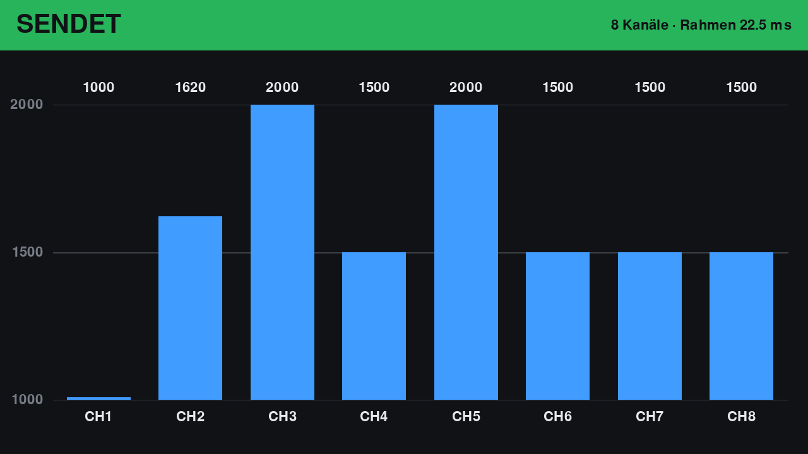

# Zusatzanleitung: Kanalanzeige auf dem Touch Display 2

Diese Anleitung ist eine **Ergänzung** zur [Einsteiger-Anleitung](ANLEITUNG.md). Mach dort zuerst die
Schritte 1–8 (Pi vorbereiten, Software installieren, Joystick einrichten).

Danach zeigt ein **Raspberry Pi Touch Display 2 (7 Zoll)** am Pi live an, welche Werte gerade an die
Fernsteuerung gehen: ein Balken pro Kanal, mit Zahl.

Rechne mit **30–45 Minuten**.

---

## 1. Was du siehst



- **Oben ein farbiger Balken mit dem Zustand:**

  | Farbe | Text | Bedeutung |
  |-------|------|-----------|
  | grün | SENDET | der Pi schickt das PPM-Signal mit den angezeigten Werten |
  | orange | SENDET NEUTRAL – Joystick getrennt | Joystick ab, der Pi schickt Mittelwerte (nur mit `on_lost: neutral`) |
  | rot | GESTOPPT – kein PPM-Signal | der Pi schickt **nichts**; die Fernsteuerung meldet „Trainer signal lost“ |
  | grau | KEINE DATEN / WARTE AUF DATEN | das Trainer-Programm läuft nicht (oder ist abgestürzt) |

- Rechts oben: wie viele Kanäle gesendet werden und wie lang ein PPM-Rahmen ist.
- **Ein Balken pro Kanal** (CH1, CH2 …). Unten = 1000, Mitte = 1500, oben = 2000 (Mikrosekunden).
  Die Zahl über dem Balken ist der genaue Wert. Ist der Zustand nicht grün, werden die Balken grau:
  Sie zeigen dann die letzten Werte, aber die gehen gerade **nicht** raus.

Die Anzeige ist ein eigenes Programm. Stürzt sie ab oder hängt sie, läuft das Signal an die
Fernsteuerung ungestört weiter.

## 2. Wie viele Kanäle werden angezeigt?

Genau so viele, wie der Pi sendet. Das steht in der `config.yaml` unter `channels:` (Standard: **8**).

Es gibt eine Obergrenze, weil alle Kanäle in einen PPM-Rahmen passen müssen. Jeder Kanal kann bis zu
2000 µs lang sein, danach braucht es mindestens 3000 µs Pause:

| `frame_us` (Rahmenlänge) | höchstens so viele Kanäle |
|--------------------------|---------------------------|
| 22500 (Standard, Pocket) | **9** |
| 27000 | 12 |
| 35000 | 16 |

Stellst du mehr Kanäle ein, als passen, startet das Programm gar nicht erst und sagt, wie viele
passen. Die Rahmenlänge muss an der Fernsteuerung gleich eingestellt sein (Pocket: Model Setup >
Trainer > PPM frame). **Getestet ist nur 8 Kanäle / 22,5 ms.** Was die Pocket mit längeren Rahmen
oder mehr als 8 Kanälen macht, ist nicht ausprobiert.

## 3. Was du brauchst

| Teil | Hinweis |
|------|---------|
| Raspberry Pi Touch Display 2, 7 Zoll | mit dem beiliegenden **22-auf-15-Pin-Flachbandkabel** und dem **Stromkabel** |
| Raspberry Pi OS **mit Desktop** | die normale Version aus der Einsteiger-Anleitung, Schritt 5. **Lite reicht nicht**, siehe Abschnitt 9 |

## 4. Achtung: Pin 6 wird für das Display gebraucht

Das Display bekommt seinen Strom über **Pin 2 (5 V)** und **Pin 6 (GND)**. Pin 6 ist in der
Einsteiger-Anleitung aber die Masse des Trainer-Kabels.

**Lösung:** Die Masse des Trainer-Kabels kommt auf **Pin 9**. Pin 9 ist ebenfalls GND und liegt in
der unteren Reihe direkt links neben Pin 11:

```
          Rand der Platine
  │  2   4   6   8  10  12  …     obere Reihe:  2 = 5 V (Display rot), 6 = GND (Display schwarz)
  │  1   3   5   7  [9] [11] …    untere Reihe: 9 = GND (Trainer-Kabel, Schaft), 11 = Signal (Trainer-Kabel, Spitze)
          Mitte der Platine                     → USB/Netzwerk rechts
```

Kontrolle mit dem Multimeter (Pi aus, Durchgangsprüfung): Zwischen Pin 9 und dem Metallgehäuse einer
USB-Buchse muss es **piepen**.

## 5. Display anschließen (Pi aus!)

Die offizielle Anleitung mit Bildern: <https://www.raspberrypi.com/documentation/accessories/touch-display-2.html>.
Kurz:

1. Pi herunterfahren (`sudo poweroff`) und **Netzteil ziehen**.
2. Trainer-Kabel: das Jumper-Kabel der Masse von **Pin 6 auf Pin 9** umstecken. Das Signal bleibt auf Pin 11.
3. **Flachbandkabel:** das **schmale** Ende (22 Pin) in eine der beiden Display-Buchsen am Pi 5
   (beschriftet `CAM/DISP`), das **breite** Ende (15 Pin) ans Display. Die Metallkontakte zeigen am
   Display nach oben, am Pi zu den USB- und Netzwerkbuchsen. Die Klemmbügel vorsichtig öffnen und
   wieder schließen.
4. **Stromkabel:** kleiner Stecker ans Display (Buchse `J1`), das andere Ende auf die Stiftleiste:
   **rot auf Pin 2, schwarz auf Pin 6.** Falsch herum kann das Display kaputtgehen, also zweimal prüfen.
5. Netzteil wieder einstecken. Nach dem Start erscheint der Desktop auf dem Display.

## 6. Display quer stellen

Das Display steht von Haus aus **hochkant**. Die Anzeige ist für **quer** gemacht.

Am einfachsten: auf dem Desktop **Einstellungen > Control Centre > Screens**, auf das Rechteck
`DSI-1` rechtsklicken, **Orientation** wählen (Left oder Right, je nachdem, wie herum das Display
steht), **Apply**.

Lässt du es hochkant, dreht die Anzeige ihr Bild selbst (siehe Abschnitt 8, `--rotate`).

## 7. Anzeige starten

Die Anzeige braucht pygame. Falls du die [pygame-Zusatzanleitung](PYGAME.md) schon gemacht hast, ist
es schon da. Sonst einmal:

```
cd ~/joystick-trainer
.venv/bin/pip install -e ".[pygame]"
```

**Wichtig:** Die Anzeige muss **auf dem Desktop des Pi** gestartet werden: im Terminal **auf dem
Display selbst** (Tastatur am Pi), nicht über SSH vom PC.

1. Terminal auf dem Pi öffnen, Anzeige starten:

   ```
   cd ~/joystick-trainer
   .venv/bin/joystick-trainer-display
   ```

   Das Bild wird schwarz, oben steht grau **WARTE AUF DATEN**. Das ist richtig, das Trainer-Programm
   läuft ja noch nicht.

2. Ein **zweites** Terminal öffnen (z. B. über SSH vom PC, das geht hier) und das Trainer-Programm wie
   gewohnt starten, erst als Probelauf:

   ```
   cd ~/joystick-trainer
   .venv/bin/joystick-trainer config.yaml
   ```

3. Joystick bewegen: Die Balken müssen mitgehen, oben steht grün **SENDET**. (Beim Probelauf mit
   `sink: print` geht nichts an den Pin. „SENDET“ heißt dann: Diese Werte *würden* gesendet.)
4. Trainer-Programm mit **Strg + C** beenden: Nach einer halben Sekunde wird die Anzeige grau,
   **KEINE DATEN**.

Die Anzeige beendest du mit **Esc** oder **q** auf der Tastatur am Pi, oder mit **Strg + C** in ihrem
Terminal.

Mit Senden an die Fernsteuerung (Einsteiger-Anleitung, Schritt 11) geht es genauso: Anzeige starten,
dann `.venv/bin/joystick-trainer config.lgpio.yaml`.

## 8. Einstellungen

| Was | Wie |
|-----|-----|
| Bild steht auf dem Kopf / ist gedreht | `.venv/bin/joystick-trainer-display --rotate 270` (oder `90`, `180`, `0`). Standard `auto` dreht ein hochkant stehendes Display auf quer |
| Im Fenster statt Vollbild (zum Ausprobieren am Desktop) | `.venv/bin/joystick-trainer-display --window` |
| Anzeige ganz abschalten | in der `config.yaml` eine Zeile `display: {enabled: false}` einfügen |
| Anzeige auf einem anderen Rechner | dort `joystick-trainer-display --listen 0.0.0.0` starten, am Pi in der `config.yaml`: `display: {host: <IP des Rechners>}` |

Das Trainer-Programm schickt die Werte 20-mal pro Sekunde an Port 5600 auf dem Pi selbst (UDP). Läuft
keine Anzeige, passiert nichts weiter.

## 9. Grenzen und offene Punkte

- **Raspberry Pi OS Lite (ohne Desktop) geht nicht:** Das pygame aus `pip` kann nur in einem Desktop
  zeichnen, nicht direkt auf den Bildschirm. Geprüft am 2026-10-22 („kmsdrm not available“).
- **Nicht am echten Touch Display 2 getestet.** Getestet ist: Die Anzeige zeichnet 8 und 16 Kanäle
  richtig (als Bild erzeugt), das Trainer-Programm schickt die Werte, und die Anzeige erkennt, wenn
  keine Daten mehr kommen.
- **Kein Autostart.** Die Anzeige muss jedes Mal von Hand gestartet werden. Ein Autostart kommt, wenn
  sie auf einem echten Display gelaufen ist.
- Der Touchscreen wird nicht benutzt; die Anzeige zeigt nur an.
- Die Anzeige zeigt, was das Programm an die Ausgabe **übergibt**. Ob das Signal am Kabel auch
  wirklich ankommt, zeigt nur die Fernsteuerung (Kanalanzeige, „Trainer signal lost/recovered“).

## 10. Wenn etwas nicht klappt

| Was du siehst | Was du tun kannst |
|---------------|-------------------|
| `No module named 'pygame'` | Abschnitt 7: pygame installieren |
| `No available video device` oder `kmsdrm not available` | du hast über SSH gestartet oder nutzt Lite: im Terminal **auf dem Pi-Desktop** starten |
| `Address already in use` | die Anzeige läuft schon (in einem anderen Terminal); diese beenden |
| bleibt bei WARTE AUF DATEN, obwohl das Trainer-Programm läuft | steht in der `config.yaml` `display: {enabled: false}`? Oder ein anderer `host:`? |
| `10 channels need frame_us >= 23000` | zu viele Kanäle für die Rahmenlänge, siehe Abschnitt 2 |
| Display bleibt schwarz, auch beim Start des Pi | Flachbandkabel prüfen (richtig herum, Bügel zu?), Stromkabel rot auf Pin 2 |
